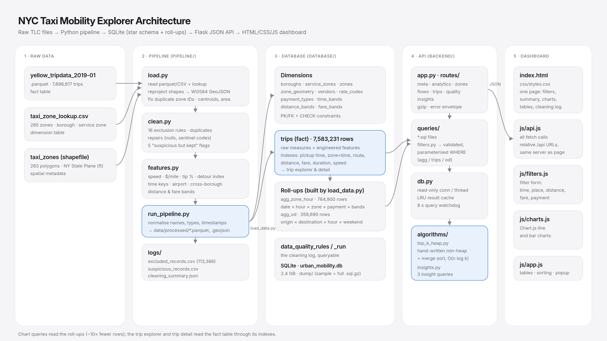

# Urban Mobility Data Explorer

How New York moved in January 2019. This project cleans **7.7 million NYC yellow-taxi trips**, stores them in a normalised SQLite database and serves an interactive dashboard for exploring urban mobility by time, place, route and price.



| | |
|---|---|
| **Pipeline** | Python · pandas · pyarrow. Loads the parquet trips, zone lookup and zone shapefile; applies 16 cleaning rules (every exclusion is logged) and engineers 4 features. |
| **Database** | SQLite star schema, 10 dimension tables, indexed `trips` fact table (7,583,231 rows), plus two roll-up tables for fast charts. |
| **Backend** | Flask JSON API: parameterised SQL, validated filters, result cache, query watchdog. |
| **Algorithm** | Hand-written binary min-heap for top-K ranking, O(n log k) (`algorithms/top_k_heap.py`). |
| **Frontend** | Plain HTML, CSS and JavaScript with Chart.js: a filter form, summary cards, charts, ranking tables, a sortable trip table and a trip-detail popup. |

Further documentation:
- [docs/api_contract.md](docs/api_contract.md): every API endpoint.

---

## 1. Setup

You need Python 3.10 or newer, about 4 GB of free disk and about 6 GB of RAM for the pipeline step.

```bash
git clone https://github.com/ixhm-brix/nyc-taxi-mobility-explorer.git
cd nyc-taxi-mobility-explorer
python3 -m venv .venv
source .venv/bin/activate          # Windows: .venv\Scripts\activate
pip install -r requirements.txt
cp .env.example .env               # optional; the defaults work
```

## 2. Build the data and the database

Nothing is stored by hand: the database is built from the official TLC files with two commands.

```bash
python pipeline/run_pipeline.py        # downloads the raw files if missing, cleans them → data/processed/
python database/load_data.py           # builds database/urban_mobility.db from data/processed/
```

The first command downloads three files from the TLC website into `data/raw/`, skipping any that are already there (so you can also drop in your own copies):

| File | What it is |
|---|---|
| `yellow_tripdata_2019-01.parquet` | trip records (fact table) |
| `taxi_zone_lookup.csv` | zone → borough / service zone |
| `taxi_zones.zip` | zone boundaries (shapefile), unzipped to `data/raw/taxi_zones/` |

**Choosing how much data to load:**

```bash
python pipeline/run_pipeline.py --months 2019-01 2019-02 2019-03   # several months
python pipeline/run_pipeline.py --limit 100000                     # quick test: first 100k trips per month
python pipeline/download.py --months 2019-04                       # only download, don't process
```

Then run `python database/load_data.py` again to rebuild the database. The dashboard's date filters adjust to whatever months were loaded.

Timings for the full January (7.7M trips): about 2–3 minutes for the pipeline and 4 minutes for the database.

**SQL dumps:** a small sample dump (`database/dump/urban_mobility_sample.sql`: every table, all reference data and 500 trips) is committed. The full dump is generated:

```bash
python database/load_data.py --dump      # rebuild + write sample and full dumps to database/dump/
python database/load_data.py --dump-only # just a small sample dump from the existing database
```

## 3. Run the app

```bash
python backend/app.py
```

Then open **http://127.0.0.1:5000**. The Flask server serves both the API and the dashboard.

---

## Project structure

```
nyc-taxi-mobility-explorer/
├── data/                  raw/ and processed/ (git-ignored)
├── pipeline/
│   ├── download.py        fetch the raw TLC files (any months) into data/raw/
│   ├── load.py            read parquet + lookup; reproject shapefile → GeoJSON; fix zone-ID defects
│   ├── clean.py           16 exclusion rules, repairs, duplicate detection, suspicious-record flags
│   ├── features.py        speed, $/mile, card tip %, detour index (+ time keys, bands)
│   ├── run_pipeline.py    entry point; normalises names, types and timestamps
│   └── logs/              excluded_records.csv · suspicious_records.csv · cleaning_summary.json
├── database/
│   ├── schema.sql         tables, keys, CHECK constraints, indexes (each one justified)
│   ├── load_data.py       bulk insert → indexes → roll-ups → integrity checks → ANALYZE
│   └── dump/              urban_mobility_sample.sql (committed); full .sql.gz from load_data.py --dump (git-ignored)
├── backend/
│   ├── app.py             Flask entry point, error envelope, gzip, static hosting
│   ├── db.py              read-only connections, LRU cache, query watchdog
│   ├── routes/            meta · analytics · zones · flows · trips · quality · insights
│   └── queries/           the SQL behind every filter (*.sql) + filters.py (WHERE builder)
├── algorithms/
│   ├── top_k_heap.py      manual min-heap + merge sort; run it to self-test
│   └── insights.py        the three insight queries
├── frontend/
│   ├── index.html
│   ├── css/styles.css
│   └── js/                api.js (all fetches) · charts.js (Chart.js) · filters.js · app.js
├── codevibe-reports/      CodeVibe analysis reports
└── docs/                  architecture.png · api_contract.md
```

## Cleaning results

| | Records |
|---|---|
| Raw | 7,696,617 |
| Excluded (logged with every rule broken) | 113,386 (1.47%) |
| **Loaded** | **7,583,231** |

The largest exclusion rules are: duration under 1 minute (67,801), zero distance (55,089), duration over 4 hours (20,766), fare below the $2.50 flag drop (10,866), negative components (7,134), speed over 65 mph (6,584) and drop-off before pickup (6,557).

The full list, the repairs and the "suspicious but kept" flags are in `pipeline/logs/cleaning_summary.json`, and in the dashboard's **Data cleaning log** section.

## The dashboard

A single page, top to bottom:

- **Filters:** start and end date, hour window (wraps past midnight, e.g. 10pm → 4am), weekdays or weekends, pickup borough, pickup zone, distance band, fare band and payment type. Press **Apply** to update every section, or **Reset** to clear.
- **Summary:** trips, revenue, average fare, distance, speed and card tip for the current filters.
- **Key insights:** three findings that recalculate under the filters.
- **Trends:** trips per day, average trips per hour, average speed by hour, and fare per mile by trip distance.
- **Locations:** top 10 pickup zones and top 10 routes, each with a dropdown to rank by trips, fare, speed, tip % or detour. The ranking uses the custom heap algorithm.
- **Trips:** a paginated table of individual trips. Click a column header to sort by pickup time, distance, duration, speed or fare; click a row to open its details, including a comparison with the same route at the same hour.
- **Data cleaning log:** every rule applied to the raw data, with how many records it excluded, flagged or repaired.

## Submission notes

- The database (2.4 GB) and the full dump are too large for GitHub, so they are generated rather than stored; `database/schema.sql` and the sample dump `database/dump/urban_mobility_sample.sql` are in the repo. To hand in the full dump, run `python database/load_data.py --dump` and share `database/dump/urban_mobility_full.sql.gz` (~290 MB) by link, for example Google Drive or a GitHub Release.
- Restore a dump with `gunzip -c database/dump/urban_mobility_full.sql.gz | sqlite3 urban_mobility.db`.

## Team Challenges.

### 1. Commits pushed under my brother's GitHub account
 
(Lewis Bagabo)During the summative, my personal laptop's battery died. Getting a replacement through my parents would take a couple of weeks, so I borrowed my brother's laptop to finish the work. While working on it, I forgot to sign out of his GitHub account in VS Code, and his Git name and email (`kellyhubert <irakellyhub@gmail.com>`) were still saved on the machine. As a result, two of my files, `backend/app.py` and `backend/db.py` (commit `a399e0c`, "Adding Flask application"), were pushed and appear under his name instead of mine. My brother is not a member of this group and did not contribute to the code. The work in that commit is mine.
 
When I noticed the mistake, I signed out of his account and set my own identity (`blewis-bump <b.lewis@alustudent.com>`) for all later commits. I chose not to remove him as a contributor or rewrite the history. The original commit would still remain in GitHub's records, and deleting a contributor could look like an attempt to hide or alter the history, which could raise an academic integrity concern. I decided it was more honest to leave the history as it is and explain it here.
 
### 2. CodeVibe AI usage increased after moving teammates' report files
 
After finishing my part of the work, I noticed that my teammates' CodeVibe reports were not stored in a proper folder. I created a `codevibe-reports` folder and moved their report files into it. As soon as I moved them, CodeVibe's AI usage numbers started rising, and it asked me to review those files. When I began reviewing them, the numbers kept going up, so I stopped reviewing immediately, because these were not my files and I had not written them with AI.
